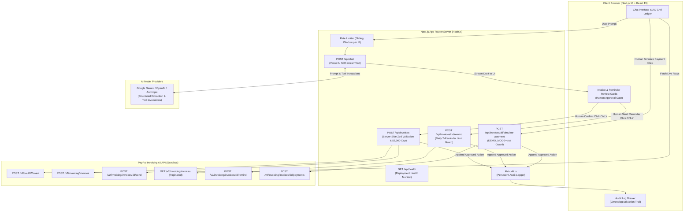

# ✈️ PayPilot

> **AI proposes · You approve · PayPal executes**

PayPilot is a chat-first accounts-receivable copilot for freelancers and small businesses, built for the PayPal AI Hackathon. Users type natural-language requests to draft professional USD invoices, monitor cashflow, search their receivables, and chase overdue accounts with tone-adaptive payment reminders. Every single financial operation strictly requires explicit human confirmation before dispatching to the live PayPal Invoicing API.

🔗 **Live Hosted Demo:** <!-- FILL IN LIVE URL HERE: https://paypilot.onrender.com --> [Pending Deployment - Fill live URL here]

---

## 📸 Screenshots

```
+-----------------------------------------------------------------------------------------+
|  ✈️ PayPilot  [Sandbox]                              [⚠️ Sandbox Demo]   [📜 Audit Log] |
+---------------------------------------------------+-------------------------------------+
|  CASHFLOW SNAPSHOT                                |  AI ACCOUNTS-RECEIVABLE CHAT        |
|  [ Outstanding: $1,650 ] [ Overdue: $3,250 ]      |                                     |
|  [ Settled Paid: $3,450 ]                         |  User: Bill Acme $1200 for cloud    |
+---------------------------------------------------+  migration due in 3 weeks           |
|  LIVE INVOICE LEDGER (AG Grid Community)          |                                     |
|  [Invoice #] [Client] [Amount] [Due Date] [Status]|  PayPilot:                          |
|  #1004  Apex Studios   $850.00   Overdue (25d)    |  +--------------------------------+ |
|  #1003  Starlight      $2400.00  Overdue (12d)    |  | 📄 Invoice Draft Review        | |
|  #1001  Acme Corp      $1200.00  Sent (in 21d)    |  | Client: Acme Enterprise Corp   | |
|  #1005  Sarah Connor   $350.00   Paid             |  | Amount: $1,200.00 (Due 21 days)| |
|                                                   |  | [ Cancel ]   [ Confirm & Send ]| |
|  [⚡ Simulate Payment (Sandbox Demo)]              |  +--------------------------------+ |
+---------------------------------------------------+-------------------------------------+
```

---

## 🔄 How It Works

PayPilot eliminates manual billing overhead while keeping human judgment firmly in control:

1. **Natural-Language Invoicing:** The user pastes client messages, agreements, or asks questions in plain English (e.g., *"Invoice Acme $1,200 for cloud migration due in 3 weeks"*).
2. **Structured Extraction (Draft Only):** PayPilot's AI extracts line items, quantities, rates, due dates, and client information into an editable UI draft card. **No invoice is created on PayPal yet.**
3. **Explicit Human Confirmation:** The user reviews, edits fields, and clicks **"Confirm & Send"**. Only this user-triggered action dispatches the payload to the server-side API.
4. **Direct PayPal Execution:** The server validates the request with Zod, enforces safety amount caps, creates the draft invoice in the PayPal Sandbox, and sends it to the client via PayPal's Invoicing v2 API.
5. **Live Financial Ledger:** Real-time receivables are pulled directly from PayPal and rendered in an AG Grid Community table with overdue alerts and cashflow aggregation cards.
6. **Tone-Adaptive Payment Reminders:** When invoices fall overdue, the user asks *"Who owes me?"* PayPilot identifies overdue accounts and drafts a reminder in the requested tone (`friendly`, `neutral`, or `firm`). Once approved, PayPal sends the reminder.
7. **Simulate Client Payment:** For demonstration and testing, judges can click *"Simulate Payment"* on any unpaid row to record an external payment via PayPal and watch the ledger update in real time.

---

## 🏛️ System Architecture



---

## 🤖 AI Tools & Model Architecture

PayPilot uses the **Vercel AI SDK (`ai@4`)** with provider abstraction supporting **Google Gemini**, **Anthropic Claude**, and **OpenAI**:

| Tool Name | Type | Description | Side Effects |
| :--- | :--- | :--- | :--- |
| `prepareInvoice` | Draft | Validates and extracts `clientName`, `clientEmail`, line items, and due dates with Zod. Returns draft card to user. | **None** (does not call PayPal) |
| `draftReminder` | Draft | Compiles invoice context into a tailored reminder note with tone options (`friendly`, `neutral`, `firm`). | **None** (does not call PayPal) |
| `listInvoices` | Read-only | Queries live invoices filtered by status, client name substring, or amount range. | **None** |
| `findOverdue` | Read-only | Identifies unpaid invoices where `due_date < today`, sorted descending by days overdue. | **None** |
| `cashflowSummary`| Read-only | Aggregates outstanding, overdue, and settled paid totals across all accounts. | **None** |
| `setGridFilter` | UI Filter | Returns a filter specification (`overdueOnly`, `minAmount`, `clientName`, `status`) to filter AG Grid. | **None** (UI-only) |

### Strict Prompt Guardrails
1. **No Autonomous Financial Actions:** The LLM cannot call any tool that sends money, generates invoices, or sends emails.
2. **Missing Field Clarifications:** If a client name, email, or amount is ambiguous or absent, the model asks a clarifying question instead of guessing.
3. **Factual Grounding:** Answers to receivables queries must originate directly from tool results, never invented from memory.

---

## 💳 PayPal Invoicing v2 REST APIs Used

PayPilot communicates with PayPal's sandbox REST APIs adhering strictly to the official schemas:

1. **`POST /v1/oauth2/token`** — Generates OAuth2 Bearer tokens using client credentials; cached in memory with proactive refresh 60 seconds before expiry.
2. **`POST /v2/invoicing/invoices`** — Creates draft invoices. Uses `Prefer: return=representation` header to obtain the assigned PayPal invoice ID directly in the response body.
3. **`POST /v2/invoicing/invoices/{id}/send`** — Dispatches the invoice to the customer's email with notification toggles.
4. **`GET /v2/invoicing/invoices`** — Paginated retrieval of sandbox invoices with `total_required=true` to build the unified ledger.
5. **`GET /v2/invoicing/invoices/{id}`** — Fetches full details and payment status for an individual invoice.
6. **`POST /v2/invoicing/invoices/{id}/remind`** — Sends customer reminders adhering to PayPal's remind payload schema (`subject`, `note`, `send_to_recipient`, `send_to_invoicer`).
7. **`POST /v2/invoicing/invoices/{id}/payments`** — Records simulated customer payments (`method: "OTHER"`), transitioning unpaid invoices to `PAID`.

---

## 🛡️ Security & Guardrails

- **AI Proposes, Human Approves:** The LLM never initiates money movements. Invoices and reminders are dispatched solely through user-triggered API buttons.
- **Server-Side Zod Validation:** LLM drafts are never trusted blindly; all inputs are re-parsed and validated against `InvoiceDraftSchema` on the server before reaching PayPal.
- **Demo Amount Cap:** Hard-coded server limit of **$5,000 USD** (`DEMO_AMOUNT_CAP_USD`) to prevent accidental excessive sandbox invoice creation.
- **IP Rate Limiting:** Sliding-window rate limiter prevents abuse across `/api/chat` (25 req/min), `/api/invoices` (10 req/min), reminders (10 req/min), and payment simulation (15 req/min).
- **Abuse Prevention on Chat:** Max conversation depth capped at 50 messages, max user message size capped at 2,500 characters, and token generation bounded by `maxTokens: 1000`.
- **DEMO_MODE Gating:** Payment simulation route is protected by `DEMO_MODE=true` and immediately returns `403 Forbidden` if disabled.
- **Immutable Audit Trail:** Every invoice creation, reminder dispatch, and payment simulation is written with ISO timestamps to memory and persisted to `audit-log.json`.
- **Secret Isolation:** Verified 0 occurrences of `NEXT_PUBLIC_` secrets. All sensitive keys are accessible only on the server through `lib/env.ts`.

---

## 💻 Local Setup & Development

### 1. Prerequisites
- **Node.js**: v18.18+ or v20+
- **PayPal Developer Account**: [developer.paypal.com](https://developer.paypal.com)
  - Create a Sandbox Business Account (the merchant / sender)
  - Create a Sandbox Personal Account (the customer / recipient)
  - Create a REST API app under **Dashboard > Applications & Credentials**

### 2. Environment Configuration
Clone the repository and copy the environment template:
```bash
git clone https://github.com/itzMANAV07/Paypilot.git
cd Paypilot
cp .env.example .env
```

Edit `.env` with your sandbox credentials and AI provider key:
```env
# PayPal Sandbox Credentials
PAYPAL_CLIENT_ID=your_sandbox_client_id
PAYPAL_CLIENT_SECRET=your_sandbox_client_secret
PAYPAL_ENV=sandbox

# Sender identity shown on invoices
INVOICER_NAME="Acme Invoicing"
INVOICER_EMAIL=your_sandbox_business_email@business.example.com

# Customer recipient for smoke tests and seeded invoices
SANDBOX_RECIPIENT_EMAIL=your_sandbox_personal_email@personal.example.com

# AI Provider Configuration (choose one: google | anthropic | openai)
LLM_PROVIDER=google
LLM_MODEL=gemini-1.5-flash
LLM_API_KEY=your_gemini_api_key

# Enable payment simulation buttons in UI
DEMO_MODE=true
```

### 3. Installation & Verification Commands
```bash
# 1. Install dependencies
npm install

# 2. Run unit test suite (77 tests)
npm test

# 3. Verify TypeScript type safety
npm run typecheck

# 4. Verify code formatting and linting
npm run lint

# 5. Execute PayPal Sandbox Smoke Test (verifies credentials end-to-end)
npm run smoke

# 6. Seed initial test accounts (creates 6 realistic active, overdue, and paid invoices)
npm run seed

# 7. Start local development server
npm run dev
```

Visit [http://localhost:3000](http://localhost:3000) in your browser.

---

## 🚀 Deploying to Render

PayPilot includes a production `render.yaml` blueprint for one-click deployment:

1. **Push your repository** to GitHub or GitLab.
2. In the [Render Dashboard](https://dashboard.render.com), click **New + > Blueprint**.
3. Select your repository. Render will automatically detect `render.yaml` and configure:
   - **Environment:** Node Web Service
   - **Build Command:** `npm ci && npm run build`
   - **Start Command:** `npm start`
   - **Health Check Path:** `/api/health`
4. When prompted by Render, supply the secret environment variables (`PAYPAL_CLIENT_ID`, `PAYPAL_CLIENT_SECRET`, `INVOICER_NAME`, `INVOICER_EMAIL`, `SANDBOX_RECIPIENT_EMAIL`, `LLM_PROVIDER`, `LLM_MODEL`, `LLM_API_KEY`).
5. Click **Apply**. Once live, seed the sandbox database by running `npm run seed` from your local machine.

---

## ⚠️ Known Limitations

1. **Sandbox Environment Only:** Engineered specifically for PayPal's Sandbox API environment to demonstrate autonomous-assisted workflows safely.
2. **Currency Locked to USD:** Invoices and payment terms are restricted to USD for hackathon evaluation consistency.
3. **Simulated Payment as External Record:** PayPal's sandbox does not permit automated self-paying of one's own invoices via credit card without interactive 3D Secure / Buyer logins. Simulated payments use PayPal's official `recordPayment` API (`method: "OTHER"`).
4. **Audit Log Persistence:** The audit trail writes to local JSON (`audit-log.json`) and memory; on ephemeral cloud containers (e.g. Render free tier), the log resets on service redeployment.

---

## 📄 License

This project is licensed under the [MIT License](LICENSE).
